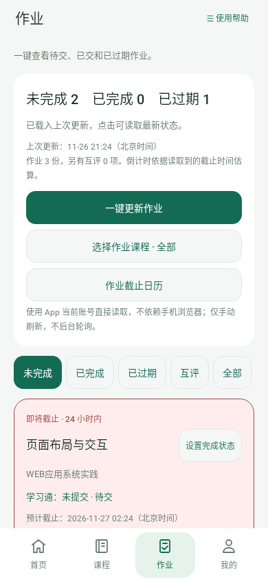
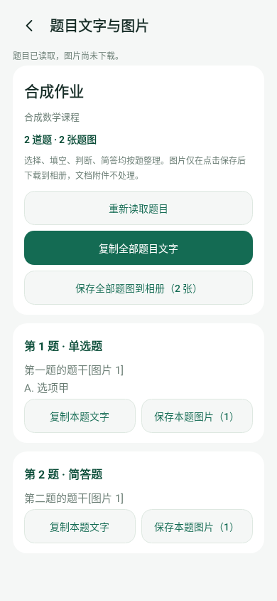

# 超星学习通助手——ClassBell

**整份作业一键复制、题图批量保存、多账号管理、应用内扫码与拍照签到、课程提醒和资料下载。** 支持 Android 8.0 及以上。

**[下载最新版 v1.5.2 APK](https://github.com/5326AAAA/ClassBell/releases/download/v1.5.2/ClassBell-v1.5.2-debug.apk)** · [Releases 下载页](https://github.com/5326AAAA/ClassBell/releases) · [完整源码 ZIP](https://github.com/5326AAAA/ClassBell/releases/download/v1.5.2/ClassBell-v1.5.2-source.zip)

## 主要功能

| 功能 | 可以做什么 | 使用入口 |
| --- | --- | --- |
| **一键复制整份作业** | 整理单选、多选、填空、判断、简答等题目，顶部一次复制全部题干和选项；每题下方还能单独复制 | 作业 → 题目文字与图片 |
| **题图保存到相册** | 手动保存整份题图，也能只保存某题的图片；保存位置为相册 / ClassBell | 题目文字与图片 → 保存题图 |
| **多个账号分别管理** | 添加、切换已授权账号，分别保存课程选择、照片配置和操作结果 | 我的 → 账号中心 / 关联账号 |
| **应用内扫码签到** | 识别当前有效二维码后立即提交；服务器明确提示过期时可重新扫码，各账号分别显示结果 | 签到中心 → 扫码签到 |
| **相册拍照与四账号并行** | 使用系统相册选图并预览；多账号分别选图、逐个核对，最多四个拍照账号并行处理 | 拍照签到详情 / 选择关联账号 |
| **签到活动与个人结果** | 查看活动名称、开始和截止时间、当前状态及个人结果；停止检测的活动归档 | 签到中心、课程详情 |
| **课堂与作业提醒** | 按课程开启提醒，查看记录；通知、锁屏和后台权限按用途列出 | 提醒课程、提醒设置、我的 → 功能权限 |
| **课程资料下载** | 查看课程资料，选择资料批量保存到指定文件夹 | 课程 → 资料 |
| **作业截止日历** | 导出待交作业的 `.ics` 日历，可附带截止前 30 分钟提醒 | 作业 → 作业截止日历 |
| **更新与故障排查** | 查看 GitHub 新版、使用指南、运行日志、提醒记录和诊断工具 | 使用帮助、更多工具 |

> [!CAUTION]
> **登录与隐私说明：我没钱买服务器，项目也没有自建服务器。登录请求直接发往学习通官方，账号密码不会上传给我，请放心登录。**
>
> 勾选“记住密码”时，登录信息仅在你自己的设备上加密保存。

### 作业文字与题图，一次整理

进入题目页后，**顶部“复制全部题目文字”用于整份作业**；下方“复制本题文字”只复制对应的一题。图片在点击保存后才下载，文档附件不处理。

<p>
  
  
</p>

## v1.5.2 重点更新

- **修复未交作业只读取一道题。** 根据答题卡逐页读取，核对题数和题目 ID；点估计的 2 题、第6章作业的 25 题均完成真机验证。
- **补齐多选题选项和空白选项标签。** 真机逐项核对第6章作业的全部 49 个选项标签，整份复制和单题复制均已验证。
- **作业 UI 以 1.5.0 为基础。** 完成状态放到标题同一行右侧，删除顶部及每项作业的学习通打开入口，深绿按钮增加按压反馈。
- 保留四账号拍照、截止日历、GitHub 检查更新等功能。

测试记录见 [v1.5.2 验证记录](docs/device-homework-validation-1.5.2.md)：完整回归 534 项通过，最后的空白选项调整另完成 61 项相关回归；真实作业复制与存图、系统相册到模拟提交、9 项扫码隔离测试均通过。相册和扫码提交测试使用隔离模拟服务。

## 下载和安装（新手看这里）

1. 用 Android 手机打开 [Releases 下载页](https://github.com/5326AAAA/ClassBell/releases)，进入 **v1.5.2**，展开下方 **Assets（附件）**。
2. 下载 **`ClassBell-v1.5.2-debug.apk`**。以 **`.apk`** 结尾的是手机安装包；源码 ZIP 用于查看和开发代码。
3. 在 **夸克、其他浏览器的下载列表，或手机文件管理器的“下载”文件夹**里找到 APK，点开，选择 **安装**。
4. 如手机提示授权，允许本次下载所用的浏览器或文件管理器安装应用，再回到 APK 继续安装。
5. 已安装本仓库同签名旧版的用户，直接选择 **更新 / 覆盖安装**，保留账号、课程和设置，无需先卸载。

最新版约 30 MB，为已签名的 debug 构建，版本 **1.5.2（52）**。自行编译时签名不同，需要使用自己的更新方式。

| 版本 | 体积 | 使用方式 |
| --- | --- | --- |
| [v1.5.2](https://github.com/5326AAAA/ClassBell/releases/tag/v1.5.2) | 约 30 MB | 当前完整功能版：原生题目整理、多账号、应用内扫码与拍照操作 |
| [v1.0.0 轻量版](https://github.com/5326AAAA/ClassBell/releases/tag/v1.0.0) | 约 3.2 MB | 保留下载；体积小，签到需要跳转学习通 |

## 第一次使用

1. 在“我的 → 账号中心”登录自己的学习通账号，需要管理其他已授权账号时添加并切换。
2. 进入“提醒课程”选择课程，再到“提醒设置”开启需要的提醒。
3. “我的 → 功能权限”按通知、后台、扫码拍照等用途列出权限及用途；照片和目标文件夹通过系统选择器选择。
4. 在“签到中心”查看活动、扫码、选图和查询个人结果。拍照时先核对账号、照片和活动要求。
5. 在“作业”页更新列表，打开“题目文字与图片”整理题目；需要答题和提交时使用“查看 / 提交作业”。
6. 在课程中查看资料，选择需要保存的内容与目标文件夹。部分资料需要先载入官方预览。

位置签到当前标记为不可用。部分官方答题、验证和预览流程按页面提示打开官方页面。AI 自动答题与讲解接入仍在方案讨论阶段，当前提供题目复制与图片整理。

## 觉得好用，欢迎在 GitHub 点个 Star

**这对我很重要，感谢支持！** 打开 [GitHub 仓库](https://github.com/5326AAAA/ClassBell)，登录 GitHub，在仓库页面找到 **Star ☆** 按钮，点一下让星星亮起来，就是给项目加星标了。

## 源码和开发

[下载 v1.5.2 完整源码 ZIP](https://github.com/5326AAAA/ClassBell/releases/download/v1.5.2/ClassBell-v1.5.2-source.zip)。包含应用源码、测试、构建配置、Gradle Wrapper 和调试脚本；账号会话、签名私钥、私有日志、缓存、用户照片和学习通拆包文件不在源码包中。

构建需要 JDK 17 或 21、Android SDK Platform 35、Build Tools 35.0.0、Go 1.24+。设置 `ANDROID_HOME`，通过 `-PclassbellGoHome` 指向 Go 安装目录。首次运行会下载 Gradle 和依赖。

```powershell
.\gradlew.bat -PclassbellGoHome="D:/program/go" :app:testDebugUnitTest :app:assembleDebug
```

```sh
sh ./gradlew -PclassbellGoHome=/path/to/go :app:testDebugUnitTest :app:assembleDebug
```

Debug APK 输出到 `app/build/outputs/apk/debug/`。Release 构建使用 `:app:assembleRelease`，发行前自行签名。按架构拆分可加 `-PclassbellAbiSplits=true`。

[USB / ADB 调试说明](docs/codex-usb-debug.md) · [作业整理说明](docs/homework-export-1.5.1.md) · [四账号拍照说明](docs/photo-concurrency-1.4.1.md) · [日历与更新工具](docs/photo-and-tools-1.4.0.md) · [学习通官方下载](https://app.chaoxing.com/)

调试桥仅在 debug 构建中启用。第三方组件许可见 `app/src/main/assets/licenses/`。
